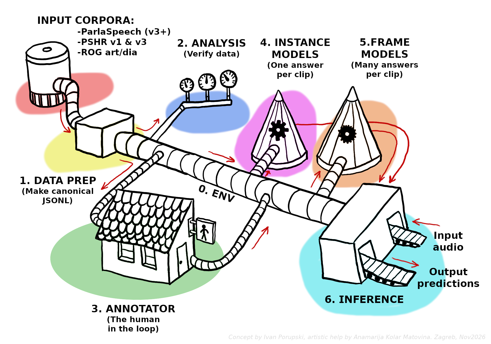

# slavic-speech-pipeline

<p>
  <a href="https://porupski.github.io/slavic-speech-pipeline/"></a>
  &nbsp;<a href="https://porupski.github.io/slavic-speech-pipeline/"><b>porupski.github.io/slavic-speech-pipeline</b></a>
</p>

[](https://colab.research.google.com/github/porupski/slavic-speech-pipeline/blob/main/colab_demo/ssp-colab_demo-speaker_id.ipynb) (DEMO)

The **slavic-speech-pipeline (ssp)** fine-tunes speech encoders — Wav2Vec2
and w2v-BERT — on Slavic speech corpora. The pipeline supports instance-level
and frame-level tasks with one shared code base. A single config setting
selects classification or regression.

<p align="center">
  
</p>

The default corpus is **ParlaSpeech 4.0** (HR, RS, CZ, PL, SI). Two pre-built
**ParlaSpeech-HR benchmark** bundles (v1 and v3) give a smaller entry
point. **ROG-Art** and **ROG-Dialog** corpora are also supported. The
long-term goal is a primary-stress frame model: the model receives one
word of audio and marks the frames that carry the primary stress.

## Quick start

Three ways to start, matched to the available hardware.

### 1. Data only (CPU)

Install the CPU environment and run chapters 1 and 2.

```bash
bash 0_env_setup/setup_env_cpu.sh
mamba activate ssp
```

### 2. Full demo (GPU)

Install the CUDA environment and run chapters 1, 2, and either 4 or 5.
A demo run on a mid-range GPU takes 1 to 2 hours for the whole
pipeline.

```bash
bash 0_env_setup/setup_env_cuda.sh
mamba activate ssp-cuda
```

### 3. No GPU

Open the Colab demo notebook:

[](https://colab.research.google.com/github/porupski/slavic-speech-pipeline/blob/main/colab_demo/ssp-colab_demo-speaker_id.ipynb) (DEMO)

A complete run takes 45 to 60 minutes on a free Colab T4 GPU.

## Chapters

- **`0_env_setup/`** — CPU and CUDA mamba envs. Frozen YAMLs.
- **`1_data_prep/`** — source corpora to canonical JSONL. Supports
  ParlaSpeech v3 and v4 (HR, RS, CZ, PL, SI), ROG (Art, Dialog), and the
  ParlaSpeech-HR v1 and v3 benchmark preps.
- **`2_data_analysis/`** — description of a canonical JSONL. Partial
  implementation. A full overhaul is pending.
- **`3_annotator/`** — mints Praat TextGrids from ParlaSpeech utterances
  for human annotation, then reads annotated TextGrids back into
  canonical JSONL. Feeds filled-pause event instances into chapter 4
  and Slovenian primary-stress word frames into chapter 5.
- **`4_instance_models/`** — instance-level classifier (gender, filled
  pauses, benchmark tasks) or regressor (age, sentiment). Shared engine
  in `utils_instance_train.py` with one `4_config.json`.
- **`5_frame_models/`** — frame-level classifier (filled-pause frames,
  primary-stress frames). An eight-task task-list runner ships in
  `53_run_task_list.py` for overnight runs.
- **`6_inference/`** — inference wrappers for the trained models. Frame
  classification is live; instance and frame regression are WIP.

## How the repository is meant to be used

Each chapter ships three parallel entry points to fit three audiences:

- **`.ipynb`** — the notebook path. Rich markdown between cells, small
  config at the top, one cell at a time. Notebooks explain *why* each
  step exists, not only *what* it does.
- **`.py`** — the same notebook as a plain script in Jupytext's
  *percent* format. Same cell boundaries, no JSON noise, easy to diff
  in any editor.
- **`run_*.py`** (chapters 4 and 5) — thin CLI wrappers around the
  shared code (`utils_*.py`) driven by the chapter's `config.json`.
  Suited for `tmux`, long GPU runs, and batch experiments. No
  prompts, no notebook state.

The `.py` and `.ipynb` files are paired by Jupytext. Edit one and
regenerate the other with `jupytext --to ipynb file.py` (or
`--to py:percent file.ipynb`). For chapters 4 and 5, the runners and
the shared code are the source of truth. The notebooks import from
them cell by cell.

## Disk requirements

`data/` (gitignored) holds raw downloads, unpacked corpora, 16 kHz
mono WAV files, and the canonical JSONLs. Chapter 1 lays that out.
Disk costs are real. The ParlaSpeech-HR v4 audio alone is about 207 GB
across 17 tarballs; the full v4 audio for all five languages is about
779 GB. The download notebook defaults to the **ParlaSpeech-HR
benchmark v3** bundle (about 9 GB, ready to train). Larger downloads
are opt-in.

## Datasets

- **ParlaSpeech 4.0** — Croatian, Serbian, Czech, Polish, and
  Slovenian parliamentary speech. Slovenian is new in v4. Filled-pause,
  silent-pause, and (HR, RS) primary-stress layers. See the
  [project page](https://clarinsi.github.io/parlaspeech/) and the
  CLARIN handles `http://hdl.handle.net/11356/1885` (transcripts) and
  `http://hdl.handle.net/11356/1889` (audio).
- **ParlaSpeech 3.0** — HR, RS, CZ, PL only. Still supported for
  comparability. CLARIN handle `http://hdl.handle.net/11356/1833`.
- **ParlaSpeech-HR benchmark v1 and v3** — pre-built speaker-disjoint
  splits for gender, speaker-id, power-status, age, and (v3)
  orientation. Hosted on Hugging Face:
  `porupski/ParlaSpeech-HR-benchmark_v1` and `_v3`.
- **ROG 1.1** — Slovenian spoken corpus with sentiment and dialogue
  acts. CLARIN handle `http://hdl.handle.net/11356/2062`.

Per-language ParlaSpeech audio handles and citations are in
`1_data_prep/1_README.md`.

## Author
[Ivan Porupski](https://porupski.github.io/cv/) - November 2026, [Jožef Stefan Institue](https://www.ijs.si/ijsw/JSI)

## License

MIT. See `LICENSE`.
